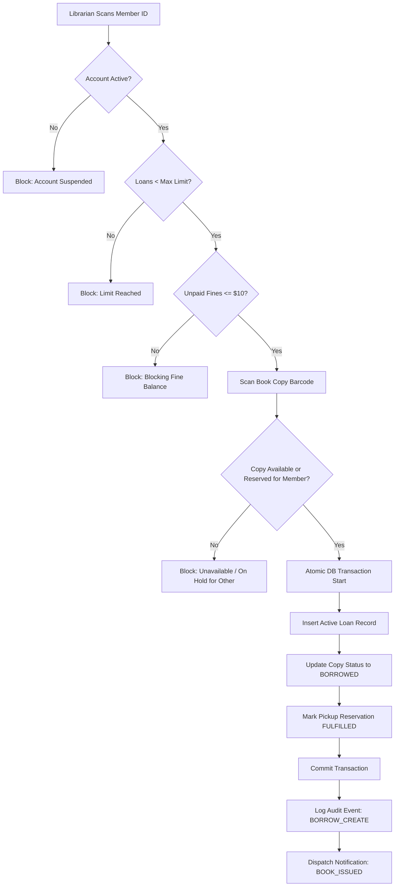
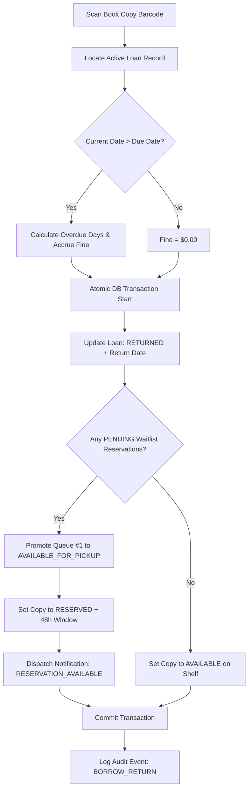

# System Architecture & Technical Design

## 1. High-Level Architecture Overview

Metropolitan LMS follows a layered, domain-driven full-stack architecture inside Next.js 16 (App Router):

```
┌────────────────────────────────────────────────────────────┐
│                    Client Layer                            │
│  Next.js App Router (React 19, Tailwind CSS, Lucide Icons) │
│  - Member Portal (/member)                                 │
│  - Librarian Console (/librarian)                          │
│  - Admin Console (/admin)                                  │
│  - Public Catalog (/ & /books/[id])                        │
└─────────────────────────────┬──────────────────────────────┘
                              │ HTTPS / JSON
┌─────────────────────────────▼──────────────────────────────┐
│                    API Gateway & Routing                   │
│  Route Handlers (/api/*) + Zod Input Validation             │
│  Session & RBAC Middleware (`requireAuth`, `hasPermission`) │
│  Standardized Response Wrapper (`apiSuccess`, `apiError`)  │
└─────────────────────────────┬──────────────────────────────┘
                              │
┌─────────────────────────────▼──────────────────────────────┐
│                    Domain Service Layer                    │
│  AuthService      - Registration, Lockout, Session tokens │
│  BookService      - Catalog search, multi-faceted filters │
│  BookCopyService  - Physical tracking, Barcode/QR gen     │
│  LoanService      - Issue, return, overdue fines, renewal │
│  ReservationService - FIFO waitlist queue & expiration     │
│  FineService      - Overdue assessment & waivers          │
│  PaymentService   - Intent creation & payment settlement  │
│  InventoryService - Shelf transfers, damage reports, CSV  │
│  AnalyticsService - Circulation trends & Recharts stats    │
│  AuditService     - Append-only event logging             │
└─────────────────────────────┬──────────────────────────────┘
                              │
┌─────────────────────────────▼──────────────────────────────┐
│                Database & Data Access Layer                │
│  Drizzle ORM (PostgreSQL Dialect)                          │
│  Connection Pool (node-postgres / PGLite dual engine)      │
│  33 Normalized Relational Tables + Indexes + Constraints  │
└────────────────────────────────────────────────────────────┘
```

---

## 2. Circulation Workflow State Machines

### A. Book Checkout (Issue Flow)


### B. Book Return Flow


---

## 3. Payment Abstraction Layer

The application implements a decoupled payment architecture through the polymorphic `PaymentProvider` interface:

```typescript
export interface PaymentProvider {
  readonly name: string;
  createPaymentIntent(params: PaymentIntentParams): Promise<PaymentIntentResult>;
  verifyPayment(params: PaymentVerificationParams): Promise<PaymentVerificationResult>;
  processRefund(transactionId: string, amount?: number): Promise<boolean>;
}
```

### Available Adapters:
1. **`DevSandboxProvider`**: Zero-dependency local verification provider for development and testing. Enables testing the full payment flow without requiring live Stripe/Razorpay keys.
2. **`StripeProvider`**: Stripe PaymentIntents API with webhook validation support.
3. **`RazorpayProvider`**: Razorpay Orders and signature verification API.

The active provider is resolved dynamically via `PaymentFactory.getProvider()`.
